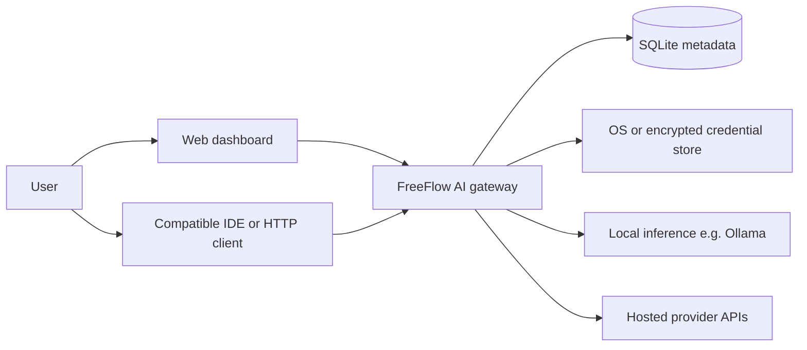
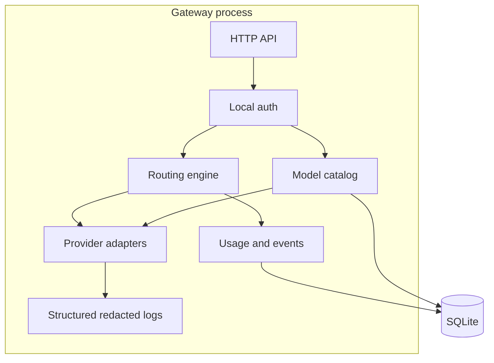

# Architecture

**Last updated:** 2026-10-29T15:14:00+05:30  
**Status:** Proposed design. No runtime components exist yet.  
**Related ADR:** [`decisions/ADR-0001-local-first-architecture.md`](decisions/ADR-0001-local-first-architecture.md)

---

## System context

The gateway and dashboard run on the user's computer for the MVP. There is no FreeFlow cloud account.

---

## Component diagram (planned)

---

## Component responsibilities

| Component | Responsibility | Non-responsibility |
|---|---|---|
| HTTP API | OpenAI-compatible subset + management APIs | Provider-specific HTTP details |
| Local auth | Validate local API token | User accounts / OAuth IdP |
| Model catalog | Persist discovered metadata, freshness, capabilities | Declaring eligibility without config/health |
| Routing engine | Select deployment, failover, record decisions | Talking to vendor SDKs directly |
| Provider adapters | Auth headers, request mapping, streaming quirks, error mapping | Routing policy |
| Usage/events | Operational metadata | Storing prompts/responses |
| Dashboard | Configuration and observability UI | Direct provider calls |
| SQLite | Settings, catalog cache, events | API keys as plaintext |
| Credential store | Secrets | Catalog rows |

---

## Request lifecycle (chat completion, planned)

1. Client sends `POST /v1/chat/completions` to loopback with local token.
2. Auth middleware validates the token.
3. Request shape is validated (schema, size limits once implemented).
4. Router resolves explicit `model` or `auto` + routing profile.
5. Capability filters remove incompatible deployments (vision, tools, context).
6. Configured, enabled, healthy, eligible deployments remain.
7. User priority and constraints pick a candidate.
8. Adapter sends the provider request. Secrets stay in the credential store.
9. Response and usage are normalized. Missing usage is **unknown**, not zero.
10. On retryable failure, check budget and maybe fail over **only if no response body has been streamed**.
11. Event row is written (no prompt text). Client receives normalized success or error.

---

## Provider adapter boundary

Core routing depends on a small protocol (names pending implementation):

- `id` / `display_name`
- `list_models()` / `refresh_catalog()` where officially supported
- `test_connection()`
- `complete_chat(request)` (non-streaming first)
- `capabilities` and error normalization helpers

Adding a provider should mean a new adapter module plus registration, not edits to routing conditionals for each vendor. See [`PROVIDER_INTEGRATIONS.md`](PROVIDER_INTEGRATIONS.md).

---

## Catalog and routing relationship

- **Catalog presence:** metadata we have seen.
- **User configuration:** credentials and enablement.
- **Capability:** what the deployment can do, if known.
- **Eligibility:** configured + enabled + capable + currently healthy enough for policy.

Routing uses eligibility, not catalog presence alone.

---

## Persistence approach

MVP: **SQLite** file on disk for:

- providers (non-secret config)
- models / provider_models
- routing profiles and rules
- request_events and provider_health_events
- app_settings

Secrets: **not** in ordinary plaintext columns. Proposed Windows approach is OS credential storage or authenticated encryption with a key held by the OS. Until that is implemented, credential write APIs stay disabled. See [`DATA_MODEL.md`](DATA_MODEL.md) and OQ-005.

Default: do not persist prompts or completions.

---

## Security boundaries

| Boundary | Rule |
|---|---|
| Network | Bind `127.0.0.1` by default |
| Browser dashboard | Same-origin local UI; CORS/CSRF reviewed in Phase 8 |
| Providers | Egress only to user-configured endpoints |
| Logs | Redact tokens, keys, Authorization headers, prompt bodies |
| Multi-user OS accounts | MVP assumes a single trusted local user |

Details: [`SECURITY_AND_PRIVACY.md`](SECURITY_AND_PRIVACY.md).

---

## Failure behavior

- Invalid client request: 4xx, no provider fan-out.
- Auth/permission from provider: do not retry endlessly; do not fail over as if it were an outage unless policy explicitly allows another credentialed provider.
- Rate limit: honor `Retry-After` when reasonable; else fail over if eligible.
- Timeout / 5xx: bounded retry with backoff and jitter.
- Context overflow: compatibility error, not generic retry.
- All candidates fail: normalized error plus attempt records.
- Catalog refresh fail: keep last cache, mark stale.
- Streaming disconnect after tokens: do not blindly switch providers (duplicates).

---

## Local versus hosted deployment

| Mode | What runs where |
|---|---|
| Local-only | Gateway + Ollama (or similar) on the machine; no hosted keys required |
| Hybrid (default intended) | Gateway local; some adapters call hosted APIs with user keys |
| Hosted FreeFlow service | **Out of MVP.** Requires separate security/cost review |

---

## Proposed technology (pending owner approval)

These are recommendations, not implemented choices:

| Layer | Proposal | Why |
|---|---|---|
| Backend | Python 3.12+, FastAPI, Uvicorn | Fits OpenAI-compatible JSON APIs and async HTTP |
| Validation | Pydantic v2 | Shared schemas for API and tests |
| DB | SQLite + a migration tool (Alembic **or** a small SQL migration folder) | Local-first, zero daemon |
| HTTP client | `httpx` | Timeouts, mocks |
| Frontend | React + TypeScript + Vite | Dashboard MVP without extra SSR complexity |
| Tests | pytest (+ pytest-asyncio), later Playwright | Mocks first |
| Local inference | Ollama HTTP API | Common on Windows; official API |

Rejected for MVP unless the owner directs otherwise: Kubernetes, a hosted database, a custom model-training pipeline, a second backend language.

---

## Tradeoffs and known limitations

- OpenAI-compatible surface will be a **subset**. Tool calling, vision, and streaming land only when adapters and tests exist.
- Cross-provider request mapping cannot be lossless; document differences per adapter.
- Catalog metadata from providers can be incomplete or stale.
- SQLite is not for multi-writer production SaaS.
- Loopback binding means other devices (including a future Android app) cannot reach the API until a later, reviewed remote-access design.
- Local model quality and latency depend on user hardware; the gateway cannot promise tokens per second.
