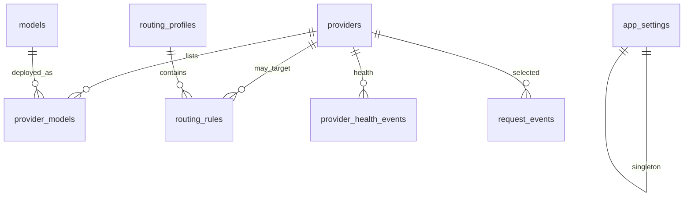

# Data model

**Last updated:** 2026-10-29T15:14:00+05:30  
**Status:** Proposed SQLite schema for MVP. Not created in the repository yet.  
**Storage engine:** SQLite (file path from configuration).

Do not store raw API keys in ordinary tables as plaintext. If a secure store is not implemented, keep credential writes disabled.

Do not persist prompt or response bodies by default.

---

## Entity relationship (logical)

Credential material lives in a **credential store**, referenced by `credential_ref`, not in `providers.api_key`.

---

## Tables

Types are SQLite-oriented. IDs are text UUIDs unless noted. Timestamps are ISO 8601 strings stored in UTC (`...Z`) with display conversion to Asia/Kolkata in the UI/docs.

### `providers`

Non-secret provider configuration.

| Column | Type | Constraints | Notes |
|---|---|---|---|
| id | TEXT | PK | UUID |
| adapter_id | TEXT | NOT NULL | e.g. `mock`, `ollama`, `openai_compat` |
| display_name | TEXT | NOT NULL | |
| base_url | TEXT | | User-configured endpoint |
| enabled | INTEGER | NOT NULL DEFAULT 1 | 0/1 |
| credential_ref | TEXT | UNIQUE | Handle into secure store; null if none |
| extra_config_json | TEXT | | Non-secret JSON (timeouts, org slug) |
| created_at | TEXT | NOT NULL | |
| updated_at | TEXT | NOT NULL | |

Indexes: `idx_providers_adapter` on `adapter_id`; `idx_providers_enabled` on `enabled`.

### `provider_credentials` (logical)

**Not a plaintext table.** Implementation options (choose in ADR before coding):

1. **Preferred on Windows:** OS credential manager via a library such as `keyring`, keyed by `credential_ref`.
2. Encrypted blob file or table using a key protected by DPAPI.
3. If neither is ready: **no persistence of secrets**; process-memory only is still discouraged for a dashboard product — disable save.

Never log `credential_ref` resolution output.

### `models`

Canonical model identity independent of a vendor deployment.

| Column | Type | Constraints | Notes |
|---|---|---|---|
| id | TEXT | PK | UUID or stable slug |
| canonical_name | TEXT | NOT NULL | Display/catalog name |
| family | TEXT | | Optional grouping |
| notes | TEXT | | |

Index: unique `canonical_name` if we treat names as unique; if not, no unique constraint — TBD during catalog implementation.

### `provider_models`

A deployable target: this provider’s ID for a model.

| Column | Type | Constraints | Notes |
|---|---|---|---|
| id | TEXT | PK | |
| provider_id | TEXT | FK providers NOT NULL | |
| model_id | TEXT | FK models | Nullable if unknown canonical |
| provider_model_id | TEXT | NOT NULL | Vendor model string |
| source | TEXT | NOT NULL | `discovered`, `local_inventory`, `manual` |
| is_local | INTEGER | NOT NULL DEFAULT 0 | Local inventory vs hosted |
| supports_text | INTEGER | | NULL = unknown |
| supports_vision | INTEGER | | NULL = unknown |
| supports_tools | INTEGER | | NULL = unknown |
| supports_streaming | INTEGER | | NULL = unknown |
| context_tokens | INTEGER | | NULL = unknown |
| max_output_tokens | INTEGER | | NULL = unknown |
| pricing_json | TEXT | | Verified metadata only |
| free_tier_label | TEXT | | Never “unlimited” unless verified |
| free_tier_verified_at | TEXT | | |
| last_seen_at | TEXT | | |
| last_checked_at | TEXT | | |
| stale | INTEGER | NOT NULL DEFAULT 0 | |
| enabled | INTEGER | NOT NULL DEFAULT 1 | |
| extra_json | TEXT | | |

Indexes: unique `(provider_id, provider_model_id)`; `idx_provider_models_local` on `is_local`; `idx_provider_models_stale` on `stale`.

### `routing_profiles`

| Column | Type | Constraints | Notes |
|---|---|---|---|
| id | TEXT | PK | |
| name | TEXT | NOT NULL UNIQUE | e.g. `coding`, `general_chat`, `reasoning` |
| task_kind | TEXT | NOT NULL | Enum string |
| allow_fallback | INTEGER | NOT NULL DEFAULT 1 | |
| max_attempts | INTEGER | NOT NULL | Bounded, e.g. 1–5 |
| created_at | TEXT | NOT NULL | |
| updated_at | TEXT | NOT NULL | |

### `routing_rules`

Ordered candidates inside a profile.

| Column | Type | Constraints | Notes |
|---|---|---|---|
| id | TEXT | PK | |
| profile_id | TEXT | FK NOT NULL | |
| priority | INTEGER | NOT NULL | Lower = higher priority |
| provider_id | TEXT | FK | Optional constraint |
| provider_model_id | TEXT | | Optional exact model |
| constraints_json | TEXT | | Capability/cost hints |

Unique `(profile_id, priority)`.

### `request_events`

Operational metadata only.

| Column | Type | Constraints | Notes |
|---|---|---|---|
| id | TEXT | PK | Request ID |
| created_at | TEXT | NOT NULL | |
| requested_model | TEXT | | |
| profile_id | TEXT | | |
| selected_provider_id | TEXT | | |
| selected_provider_model_id | TEXT | | |
| attempt_count | INTEGER | NOT NULL | |
| status | TEXT | NOT NULL | `success`, `client_error`, `provider_error`, `cancelled` |
| error_category | TEXT | | Normalized |
| failover_occurred | INTEGER | NOT NULL DEFAULT 0 | |
| failover_reason | TEXT | | |
| latency_ms | INTEGER | | |
| input_tokens | INTEGER | | NULL if provider omitted |
| output_tokens | INTEGER | | NULL if omitted |
| usage_unknown | INTEGER | NOT NULL DEFAULT 0 | 1 if tokens not supplied |
| decision_json | TEXT | | Rejection reasons; **no prompt content** |

Indexes: `idx_request_events_created` on `created_at`; `idx_request_events_status` on `status`.

**Retention (proposed):** keep 30 days or 10,000 rows, whichever policy is implemented first; document the chosen policy in settings. Deletion is a settings/diagnostics action.

### `provider_health_events`

| Column | Type | Constraints | Notes |
|---|---|---|---|
| id | TEXT | PK | |
| provider_id | TEXT | FK NOT NULL | |
| created_at | TEXT | NOT NULL | |
| ok | INTEGER | NOT NULL | |
| error_category | TEXT | | |
| latency_ms | INTEGER | | |
| cooldown_until | TEXT | | |

Index: `(provider_id, created_at)`.

### `app_settings`

| Column | Type | Constraints | Notes |
|---|---|---|---|
| key | TEXT | PK | |
| value_json | TEXT | NOT NULL | |
| updated_at | TEXT | NOT NULL | |

Examples: bind host/port, log level, retention days, default profile id. No secrets.

---

## Migration policy

- Schema changes go through versioned migrations (tool chosen in Phase 1).
- Never destructive-reset the DB in a default command.
- Backup guidance in `DEPLOYMENT.md` before reset tools exist.
- Tests use isolated temporary database files.

---

## Retention and privacy

| Data | Default |
|---|---|
| Prompts / completions | Not stored |
| API keys | Secure store only |
| Request events | Metadata; proposed time/count cap |
| Catalog cache | Until refresh replaces it; mark stale on failure |

Future prompt capture (FR-030) requires privacy review, opt-in, off by default, and deletion UI.
